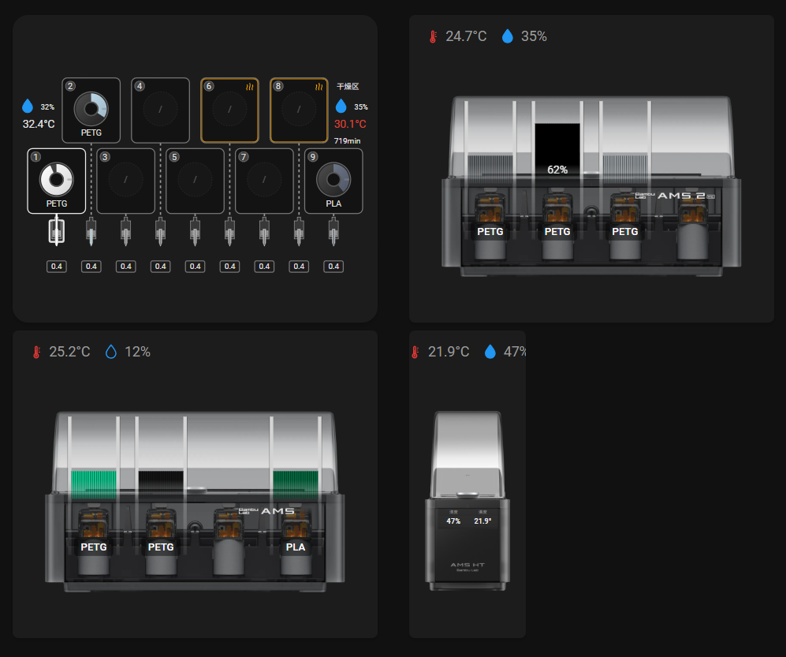
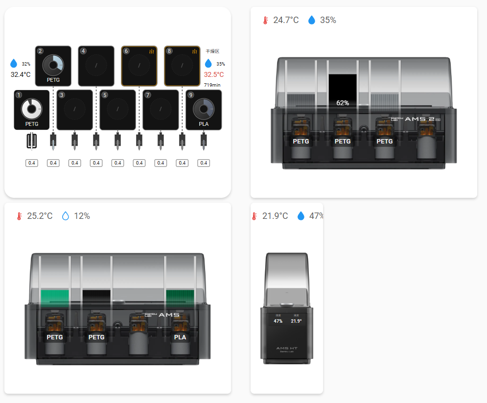

# AMS Graphic Card (all models)

English | [简体中文](README.zh-CN.md)

A Lovelace card for Bambu Lab AMS units. Every slot renders a real spool — material
colour, remaining filament, multi-colour segments, flange and hub — and the tool head
that is currently feeding is highlighted with its feed path drawn in the material colour.





## Supported models

| Model | Rendering | Slots |
|---|---|---|
| AMS 2 PRO | base / mech / brand layers | 4 |
| AMS | base / mech / brand layers | 4 |
| AMS HT | base layer + vector LCD | 1 |
| AMS-3H | pure vector | 9 (4 top, 5 bottom, staggered) |
| AMS Lite | recognised, not rendered | — |

The model is detected from the AMS device metadata reported by the `bambu_lab`
integration — no entity-name matching and no slot-count guessing. When detection does
not fit, the model can be selected manually in the card editor.

**About the AMS-3H artwork**: there is no suitable high-resolution top-down image for
this model, so the card is drawn after the native H3C interface — same layout, colour
and information zoning as the device screen — entirely in vector graphics.

## Features

- Active tool head highlighted, feed path drawn in the material colour.
- Nozzle diameter shown under every tool head (from the tool entity's `nozzle_diameter`).
- Two drying zones on the AMS-3H: temperature and humidity, plus remaining drying time
  while drying; slots of a drying zone carry a warm outline and a heat icon, and the
  temperature turns red only while that zone is drying.
- Humidity droplet: solid above 20 %, outlined at 20 % and below.
- Clicking a material label opens the integration's filament popup, falling back to the
  more-info dialog.
- Empty, offline and unknown states are distinct — no invented numbers.
- Follows the Home Assistant light and dark themes; the model base art is high-resolution
  with the outline cut to the subject, so no white fringe appears on dark backgrounds.
- Simplified Chinese and English, chosen from the Home Assistant language; English default.
- Smooth spool animation (AMS / AMS 2 PRO / AMS HT). The AMS-3H is a vector interface
  that indicates activity with highlight instead of spool rotation.

## Installation

[](https://my.home-assistant.io/redirect/marketplace_browse/?search=ams%20graphic)

[](https://my.home-assistant.io/redirect/marketplace_repositories/)

Repository URL: `https://github.com/spikekai/ha-ams-graphic-card`

If the card is not listed in the store yet, open the custom-repositories page, add the
URL above, then search for "AMS Graphic Card" in the store.

> Links from My Home Assistant only open the matching page; they never change your
> instance. The install itself is one click on “Download” in the store.

### Manual installation

```text
1. Copy ams2pro-card.js to /config/www/ams2pro-card.js
2. Copy the assets to /config/www/:
     ams2pro/base.png  ams2pro/mech.png  ams2pro/brand.png  ams2pro/card_thumb.png
     ams/base.png      ams/mech.png      ams/brand.png
     ams-ht/base.png
   (AMS-3H is vector, no assets required)
3. Settings → Dashboards → Resources → add
     /local/ams2pro-card.js?v=1.28    (JavaScript module)
```

Asset paths are derived from the directory of the card file itself, so a store install
that keeps the assets next to it works the same way.

### Adding the card

Dashboard → Add card → search “AMS Graphic Card” → select it. The card ships with a
preview and description in the picker, and everything else is configured in the visual
editor — no YAML required.

## Configuration

Open the editor after adding the card:

- **Pick the AMS device** — tray entities and artwork are bound automatically.
- **Manual model selection** when automatic detection does not fit.
- **AMS-3H** — select the nine tray entities, the temperature / humidity / remaining
  drying time entities of both drying zones, and the active tray entity.
- Temperature/humidity sensors, name, info bar, empty-slot label and spool animations
  all have their own toggles.

The YAML below is equivalent and useful for scripted or copy-paste configuration:

```yaml
type: custom:ams2pro-card
active_tray_entity: sensor.shu_fang_h3c_active_tray
zone_1_temperature_entity: sensor.shu_fang_h3c_ams_3h_zone_1_temperature
zone_1_humidity_entity: sensor.shu_fang_h3c_ams_3h_zone_1_humidity
zone_1_remaining_drying_time_entity: sensor.shu_fang_h3c_ams_3h_zone_1_remaining_drying_time
zone_2_temperature_entity: sensor.shu_fang_h3c_ams_3h_zone_2_temperature
zone_2_humidity_entity: sensor.shu_fang_h3c_ams_3h_zone_2_humidity
zone_2_remaining_drying_time_entity: sensor.shu_fang_h3c_ams_3h_zone_2_remaining_drying_time
ams3h_trays:
  - sensor.shu_fang_h3c_ams_3h_tray_1
  - sensor.shu_fang_h3c_ams_3h_tray_2
  - sensor.shu_fang_h3c_ams_3h_tray_3
  - sensor.shu_fang_h3c_ams_3h_tray_4
  - sensor.shu_fang_h3c_ams_3h_tray_5
  - sensor.shu_fang_h3c_ams_3h_tray_6
  - sensor.shu_fang_h3c_ams_3h_tray_7
  - sensor.shu_fang_h3c_ams_3h_tray_8
  - sensor.shu_fang_h3c_ams_3h_tray_9
```

## Entity contract

Tray sensors (`sensor.*_tray_N`, `sensor.*_external_spool`) are read through `hass.states`:

| Attribute | Meaning |
|---|---|
| `color` | `#RRGGBBAA`; empty trays report `#00000000` |
| `type` | material family, `Empty` when there is no spool |
| `name` | full material name |
| `remain` | remaining percentage; `-1` means not reported |
| `empty` / `unknown` | empty slot / no spool inserted |
| `active` / `in_use` | tray currently in use |
| `cols` | additional colours for multi-colour spools |

Drying zone sensors (`sensor.*_zone_N_temperature`, `_humidity`,
`_remaining_drying_time`) expose `slots`, `dry_setting.dry_duration` and
`dry_setting.dry_temperature`.

Nozzle diameter is read from the tool entity's `nozzle_diameter` attribute.

- Empty when any of: `unknown` is true, `empty` is true, `type` is `Empty`, colour is
  `#00000000`.
- Remaining: negative `remain` draws 95 %, otherwise `20 + remain × 0.75`.

## Theming

All chrome colours come from Home Assistant variables (`--primary-background-color`,
`--ha-card-background`, `--primary-text-color`, `--secondary-text-color`,
`--divider-color`, `--primary-color`). Light and dark are both verified on a live page.

## Screenshots

```text
docs/preview/dark.png    dark theme
docs/preview/light.png   light theme
```

## Known limitations

- AMS Lite is detected but not rendered.
- Drying-zone to slot mapping comes from the `slots` attribute; when it is missing the
  slots of the tested machine (6 and 8) are used.

## Notes for the reviewer

- No build step, no dependencies: one JS file plus PNG assets.
- The integration bundle and `custom_components` are never modified.
- The version constant `AMS2PRO_VERSION` doubles as the cache-buster for every asset URL.
- Optional: remaining filament of third-party (non-RFID) spools can be taken from
  Spoolman — when `sensor.spoolman_spool_*` and `extra_active_tray` exist they are used,
  otherwise the values reported by the integration are drawn.
