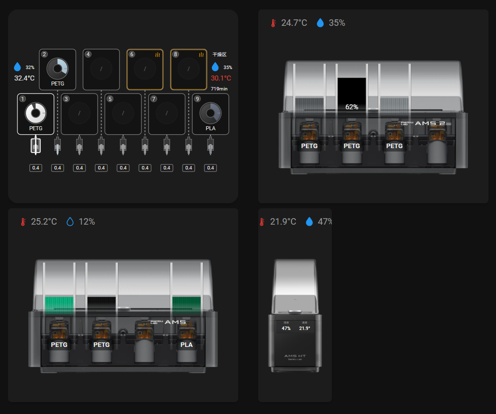
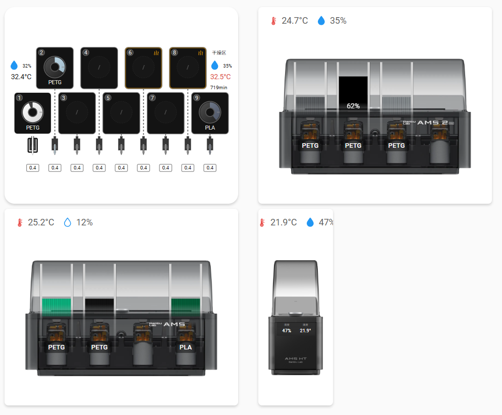

# AMS 图形卡（全机型）

[English](README.md) | 简体中文

面向 Bambu Lab AMS 的 Lovelace 卡片。每个槽位绘制真实料盘（材料色、余量、多色分段、外圈与轮毂），
正在供料的工具头高亮，供料路径以材料色绘制。





## 支持的机型

| 机型 | 渲染方式 | 槽位 |
|---|---|---|
| AMS 2 PRO | base / mech / brand 三层位图 | 4 |
| AMS | base / mech / brand 三层位图 | 4 |
| AMS HT | base 位图 + 矢量 LCD | 1 |
| AMS-3H | 纯矢量绘制 | 9（上排 4、下排 5 错位） |
| AMS Lite | 能识别，不渲染 | — |

机型依据 `bambu_lab` 集成上报的 AMS 设备信息自动判定，不依赖实体命名，也不靠槽位数猜；
自动识别不适用时，可在卡片编辑器中手动指定机型。

**关于 AMS-3H 的卡面**：该机型没有合适的高清俯视图素材，因此卡面参照 H3C 原生界面绘制，
布局、配色与信息分区与设备屏幕一致，全部由矢量图形构成。

## 功能

- 正在供料的工具头高亮，供料路径以材料色绘制。
- 每个工具头下方显示喷嘴口径（取自工具头实体的 `nozzle_diameter` 属性）。
- AMS-3H 的两个干燥区显示温度与湿度，烘干进行中显示剩余时间；属于烘干区的槽位带暖色描边
  与加热标识，温度仅在烘干进行中显示为红色。
- 湿度水滴：高于 20% 为实心，20% 及以下为空心。
- 点击材料标签打开集成自带的耗材弹窗，不可用时退回更多信息对话框。
- 空槽、离线、余量未上报三种状态分别呈现，不显示推断数值。
- 跟随 Home Assistant 的浅色与深色主题；机型底图为高清素材，轮廓按主体抠图，深色模式下无白边。
- 支持简体中文与英文，跟随 Home Assistant 语言设置，英文为默认。
- 料盘动画过渡平滑（AMS / AMS 2 PRO / AMS HT）；AMS-3H 为矢量界面，用高亮表达活动状态，
  不含料盘转动动画。

## 安装

### 一键安装（商店）

[](https://my.home-assistant.io/redirect/marketplace_browse/?search=ams%20graphic)

[](https://my.home-assistant.io/redirect/marketplace_repositories/)

仓库地址：`https://github.com/spikekai/ha-ams-graphic-card`

商店里点一次「下载」即可：卡片文件与三套素材由商店一并放下并注册资源，不需要手动复制文件、
也不需要手动添加资源。

尚未被商店收录前，用第二个按钮打开「自定义仓库」页，粘贴上面的仓库地址添加，再回商店搜索
「AMS 图形卡」安装。

> Home Assistant 的跳转链接只负责打开对应页面，不会修改你的实例；真正的安装动作由商店的
> 「下载」完成。

### 手动安装（没有商店时的兜底）

```text
1. 把 ams2pro-card.js 复制到 /config/www/ams2pro-card.js
2. 把三个素材目录整体复制到 /config/www/，保持目录结构：
     ams2pro/  （base.png  mech.png  brand.png  card_thumb.png）
     ams/      （base.png  mech.png  brand.png）
     ams-ht/   （base.png）
   AMS-3H 为矢量绘制，不需要素材
3. 设置 → 仪表盘 → 资源 → 添加
     /local/ams2pro-card.js?v=1.28    （JavaScript 模块）
```

素材路径按卡片文件自身所在目录推导，商店安装与手动安装的目录结构一致。

### 添加卡片

仪表盘 → 添加卡片 → 搜索「AMS 图形卡（全机型）」→ 选中即完成添加。选择器里自带预览图与
说明文字，其余设置在可视化编辑器里完成，不需要手写 YAML。

## 配置

添加卡片后点「编辑」：

- **选择 AMS 设备** —— 自动绑定料盘实体并匹配卡面。
- **手动指定机型** —— 自动识别不适用时使用。
- **AMS-3H** —— 逐项选择 9 个槽位实体、两个干燥区的温度 / 湿度 / 剩余时间实体，以及当前激活料盘实体。
- 温湿度传感器、名称、信息栏、空盘位标签、料盘动画各有独立开关。

以下 YAML 与编辑器等价，供脚本化配置或复制使用：

```yaml
type: custom:ams2pro-card
active_tray_entity: sensor.shu_fang_h3c_active_tray
zone_1_temperature_entity: sensor.shu_fang_h3c_ams_3h_zone_1_temperature
zone_1_humidity_entity: sensor.shu_fang_h3c_ams_3h_zone_1_humidity
zone_1_remaining_drying_time_entity: sensor.shu_fang_h3c_ams_3h_zone_1_remaining_drying_time
zone_2_temperature_entity: sensor.shu_fang_h3c_ams_3h_zone_2_temperature
zone_2_humidity_entity: sensor.shu_fang_h3c_ams_3h_zone_2_humidity
zone_2_remaining_drying_time_entity: sensor.shu_fang_h3c_ams_3h_zone_2_remaining_drying_time
ams3h_trays:
  - sensor.shu_fang_h3c_ams_3h_tray_1
  - sensor.shu_fang_h3c_ams_3h_tray_2
  - sensor.shu_fang_h3c_ams_3h_tray_3
  - sensor.shu_fang_h3c_ams_3h_tray_4
  - sensor.shu_fang_h3c_ams_3h_tray_5
  - sensor.shu_fang_h3c_ams_3h_tray_6
  - sensor.shu_fang_h3c_ams_3h_tray_7
  - sensor.shu_fang_h3c_ams_3h_tray_8
  - sensor.shu_fang_h3c_ams_3h_tray_9
```

## 实体契约

料盘传感器（`sensor.*_tray_N`、`sensor.*_external_spool`）通过 `hass.states` 读取：

| 属性 | 含义 |
|---|---|
| `color` | `#RRGGBBAA`；空盘为 `#00000000` |
| `type` | 材料族，无料时为 `Empty` |
| `name` | 材料全名 |
| `remain` | 剩余百分比；`-1` 表示未上报 |
| `empty` / `unknown` | 空槽 / 未插盘 |
| `active` / `in_use` | 当前在用 |
| `cols` | 多色料盘的附加颜色 |

干燥区传感器（`sensor.*_zone_N_temperature`、`_humidity`、`_remaining_drying_time`）提供
`slots`、`dry_setting.dry_duration`、`dry_setting.dry_temperature`。

喷嘴口径取自工具头实体的 `nozzle_diameter` 属性。

- 判空：`unknown` 为真、`empty` 为真、`type` 为 `Empty`、颜色为 `#00000000`，四者任一即为空槽。
- 余量：`remain` 为负按 95% 绘制，否则按 `20 + remain × 0.75`。

## 主题

卡面配色取自 Home Assistant 变量（`--primary-background-color`、`--ha-card-background`、
`--primary-text-color`、`--secondary-text-color`、`--divider-color`、`--primary-color`），
深色与浅色均在真实页面验证。

## 截图

```text
docs/preview/dark.png    深色
docs/preview/light.png   浅色
```

## 已知限制

- AMS Lite 仅识别，不渲染。
- 干燥区与槽位的对应关系取自 `slots` 属性；该属性缺失时按测试机型的槽位（6、8）显示。

## 给维护者的说明

- 无构建、无依赖：一个 JS 文件加若干 PNG。
- 不修改集成包，不触碰 `custom_components`。
- 版本常量 `AMS2PRO_VERSION` 同时用作所有素材 URL 的缓存戳。
- 可选：第三方无 RFID 料盘的余量可由 Spoolman 补足 —— 存在 `sensor.spoolman_spool_*` 与
  `extra_active_tray` 时参与计算，否则按集成上报值绘制。
